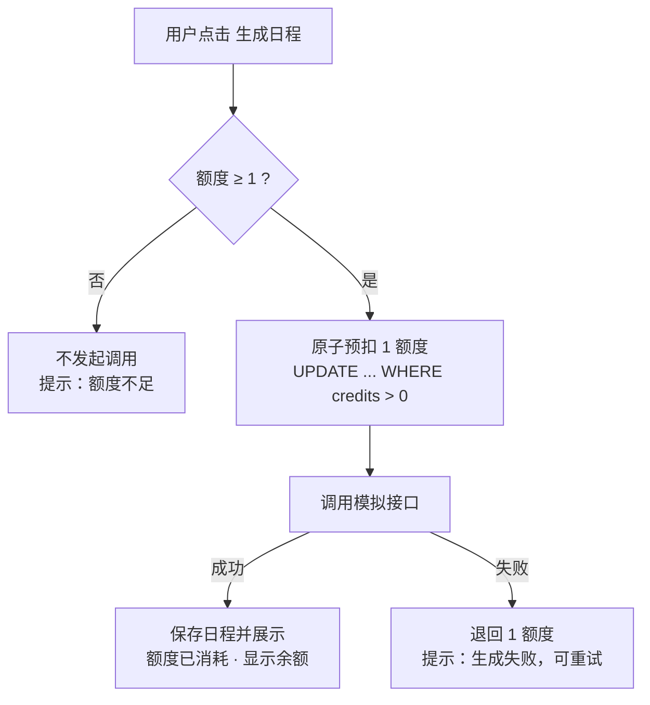

# 产品方案：日程生成的额度处理

> 结论先行：把「先调用、后扣费」改成「先预扣、成功消耗、失败退回」，并让每个操作结果都附带下一步指引。
> 当前状态：代码已实现，脚本级验证已通过（见 `VERIFICATION.md`），UI 级验证受运行环境限制部分未执行，已如实标注。

## 问题判断

阅读 `src/demo-ai-app/operations.ts` 的 `generatePlan` 后，现状有四个问题：

| # | 问题 | 现状行为 | 用户/业务后果 |
|---|------|---------|--------------|
| 1 | 额度不足仍会调用模型 | 额度检查发生在 `generateMockSchedule` 调用之后 | 用户等了 500ms 才被告知失败，且浪费一次本不该发生的调用 |
| 2 | 失败路径语义不明 | 失败时抛错，扣费事务不再执行（碰巧不扣费），但用户只收到笼统的 500 报错 | 失败后用户不知道发生了什么、也不知道可以重试；方案改为预扣后，失败退回成为必须显式实现的逻辑 |
| 3 | 并发会透支 | 「读 credits → 判断 >0 → 减 1」三步不是原子操作 | 3 个额度可能被 4 次以上的并发生成消耗掉 |
| 4 | 结果提示不完整 | 额度不足的提示没有解释规则；成功后不显示剩余额度 | 用户不知道还剩多少、下次还能不能生成 |

## 方案：预扣-退回

核心改动只有一个顺序：**在发起模型调用之前，先用一条带条件的原子 UPDATE 把额度扣掉**；调用成功就消耗，明确失败就退回。



**并发处理的一句话解释**：预扣不是「先查再减」，而是一条 SQL：

```sql
UPDATE "User" SET credits = credits - 1 WHERE id = $1 AND credits > 0
```

数据库对同一行的并发更新天然串行，所以两个请求同时预扣时只有一个能把行匹配上（通过返回的 affected count 判断），余额不可能变成负数。实现见 `src/demo-ai-app/credits.ts` 的 `reserveCredit`。

**为什么不在调用成功后再扣？** 成功后扣费无法防止并发透支（两个请求都看到余额 1、都调用、都扣费）。预扣把「能不能调用」的决定权交给数据库的原子判断，这是整个方案里唯一防住透支的位置。

## 用户提示设计

对应目标规则第 5 条「用户能够理解操作结果，并知道接下来可以做什么」：

| 场景 | 用户看到的提示 | 系统动作 |
|------|--------------|---------|
| 生成成功 | 「日程已生成，本次消耗 1 个额度，剩余 X 个。」 | 保存日程 → 扣减生效 → 返回结果与最新余额 |
| 额度不足 | 「额度不足，本次未发起生成。成功生成一次日程消耗 1 个额度。」 | 调用前检查失败 → 直接返回，不发起接口调用 |
| 模型失败 | 「生成失败，额度已退回，你可以重试。」 | 接口明确失败 → 退回预扣额度 → 告知结果与下一步 |
| 并发请求 | 与「额度不足」相同（第二个请求看到余额已被扣走） | 两个请求同时预扣，只有一次成功，余额不为负 |

页面在生成按钮附近常显「剩余额度：X」，用户不用等到失败才知道余额（实现见 `DemoAppPage.tsx` 的 `credits-display`）。

## 开发任务拆解

| # | 任务 | 涉及文件 | 说明 |
|---|------|---------|------|
| 1 | 抽出额度原子操作 | `src/demo-ai-app/credits.ts`（新增） | 预扣/退回/查询三个函数，只依赖传入的 Prisma delegate，便于测试 |
| 2 | 重排 generatePlan 流程 | `src/demo-ai-app/operations.ts` | 预扣 → 调用 → 成功保存 / 失败退回；返回值带上剩余额度 |
| 3 | 新增余额查询 | `operations.ts` + `demo-ai-app.wasp.ts` | `getUserCredits` 查询，供页面常显余额 |
| 4 | 前端提示与余额展示 | `src/demo-ai-app/DemoAppPage.tsx` | 四场景文案、剩余额度展示、失败后刷新余额 |
| 5 | 可重复验证脚本 | `scripts/verify-credits.mjs`（新增） | 对真实 PostgreSQL 复现四场景，见 `VERIFICATION.md` |

## 范围取舍与假设

- 按 TASK.md 约定，只考虑单服务、单数据库，不做支付、订阅、跨账号防刷、Token 计价。
- **已知限制（明确不做，按 TASK.md 范围）**：预扣成功后如果服务崩溃，这一次预扣的额度不会自动退回。补偿需要引入「预扣记录」状态机或定时对账，超出本题范围，作为待办留给接手者（见 `VERIFICATION.md` 待办区）。
- 假设额度变更只发生在生成流程内，不引入管理端调整额度的入口。
